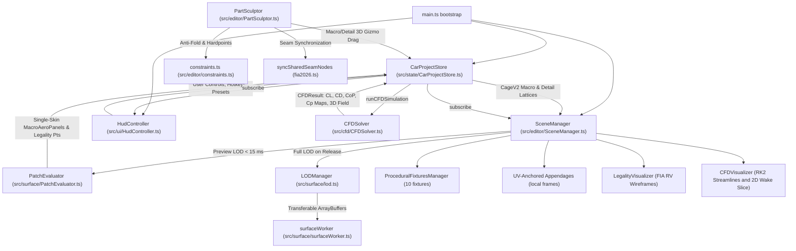

# Technical Architecture — F1 2026 Aero Development & CFD Lab

This document details the runtime data flow, 100% procedural parts-first geometry pipeline, bicubic Catmull-Rom patch evaluation, WebWorker LOD tessellation, reactive state architecture, and rendering subsystems.

---

## 1. High-Level System Data Flow

---

## 2. 100% Procedural Parts-First Architecture & Shared Seam Topology

The simulation features **zero runtime GLB/GLTF polygon file dependencies**. All 11 FIA 2026 aerodynamic and bodywork components are generated directly from mathematical B-spline/NURBS-style control lattices (`CageV2`):

1. **5 Physical Boundary Seams Welded to Exact 0.000000 mm Gap:**
   - `front_wing` (pylon attachment) ↔ `nosecone`
   - `nosecone` (bulkhead) ↔ `monocoque`
   - `monocoque` (cockpit trailing edge) ↔ `engine_cover`
   - `monocoque` (chassis floor transition) ↔ `floor` (bib)
   - `floor` (Venturi throat exit) ↔ `diffuser` (inlet ramp)
   All 5 seams maintain exact continuous C0 positional contact at baseline and propagate bilateral movements across adjacent components during sculpting via `syncSharedSeamNodes()`.
2. **Two-Tier Control Cages (`CageV2`):**
   - **`macro` Grid (`cols × rows`):** Coarse, intuitive engineering handles designed for direct user manipulation via 3D gizmos and soft falloff.
   - **`detail` Grid (`detailCols × detailRows`):** Higher-density control lattice enabling fine-grained local aerodynamic features and accurate curvature evaluation.
   - **`detailOffsets`:** Differential displacement offsets stored relative to the interpolated macro grid, preserving local sculpting detail when macro handles are modified.

---

## 3. Catmull-Rom Patch Evaluator & Constraints (`src/surface/`)

`PatchEvaluator` evaluates parametric bicubic Catmull-Rom patches into watertight Three.js `BufferGeometry`:

- **Closed 3D Shells with Clean Normals:**
  - Evaluates upper skin, thickness-extruded lower skin, and perimeter edge-loop boundary caps to form closed 3D aerodynamic surfaces.
  - Vertex normals are computed analytically from surface tangent cross-products `∂S/∂u × ∂S/∂v` and welded at the centerline `X = 0`.
- **Anti-Fold & Normal Inversion Protection (`src/editor/constraints.ts`):**
  - Before committing a candidate handle drag, `checkAntiFold()` calculates surface normal dot products against the baseline configuration. If an extreme twist would cause surface self-intersection or normal inversion (dot product `< 0`), the drag candidate is rejected.
- **Hardpoint Constraints:**
  - Nodes anchored to fixed suspension pick-up points or crash-structure hardpoints are constrained via `isNodeOnLockedHardpoint()`, ensuring structural mounting integrity.

---

## 4. Two-Tier Adaptive LOD Pipeline (`src/surface/lod.ts`, `src/surface/surfaceWorker.ts`)

To balance 60 FPS interactive sculpting responsiveness with production-grade visual fidelity:

1. **Preview LOD (~31k Triangles, < 15 ms):**
   - Evaluated synchronously on the main thread during pointer drags using decimated evaluation steps (`evalCols`, `evalRows`).
   - Uses zero heap allocations inside the hot vertex loops via reusable flat `Float32Array` buffers.
2. **Full LOD (~994k Triangles, ~100 ms):**
   - Dispatched to a dedicated WebWorker (`surfaceWorker.ts`) upon pointer release (`dragging-changed: false`).
   - Transfers zero-copy `ArrayBuffer`s for positions, normals, and indices directly back to the GPU.
   - Broadcasts real-time state (`idle`, `preview_active`, `tessellating_full`, `full_ready`) to the Studio HUD status pill.

---

## 5. Procedural Vehicle Fixtures & UV-Anchored Appendages (`src/geometry/`)

- **`ProceduralFixturesManager` (`src/geometry/fixtures.ts`):**
  - Procedurally builds 10 vehicle fixtures: 4 spinning wheels (with live stance pivots for track offset, camber, toe, and rim dish), titanium Halo structure, rearview mirrors, driver helmet & visor, cockpit interior, and exhaust tailpipe.
  - All fixtures support independent visibility toggles and ghost-opacity shading in CAD Sculpt mode.
- **UV-Anchored Appendages (`src/geometry/proceduralElements.ts`):**
  - Appendages (diveplanes, Gurney flaps, louvers, fences, strakes) define a parent `(u, v)` anchor point.
  - Evaluated inside an orthonormal local surface frame `(origin, tangentU, tangentV, normal)` so appendages deform, pitch, and scale seamlessly along with the underlying bodywork.

---

## 6. Coupled 3D CFD Solver & Decimated Panel Extraction (`src/cfd/CFDSolver.ts`)

- **Single-Skin Planform Aerodynamic Area Extraction:**
  - Because procedural meshes represent closed 3D shells (upper + lower skins), `PatchEvaluator.extractMeshPanelsAndLegality()` filters starboard (`+X`) surface triangles and normalizes total surface area by 2.0 to match the true single-skin planform aerodynamic area.
- **Inlined Space-Marching Optimization:**
  - Flow slices in `marchFlowSlices` use inlined bilinear/trilinear index and weight calculations with slice-filtered rotating wheels, dropping CFD solve turnaround to ~19–38 ms.

---

## 7. Studio HUD V2 & Viewport (`src/ui/HudController.ts`, `src/style.css`)

- **Handle Level Toggle:** Dedicated segmented controls and keyboard shortcut `M` switch seamlessly between `macro` and `detail` handle manipulation.
- **WebWorker LOD Status Badge:** Live HUD pill indicating tessellation state (`Preview LOD`, `Tessellating Full...`, `Full LOD (ms)`).
- **V1 → V2 Migration Toast:** Automatic notification toast when legacy design snapshots are transparently migrated and welded to the procedural V2 architecture.
- **Vehicle Fixtures Control Panel:** Expandable drawer for individual or bulk fixture visibility toggling.
- **Camera Navigation Contract:** Unaltered `WASD` / `Arrow` horizontal glide, `Q`/`E` vertical movement, and `Shift` sprint.
